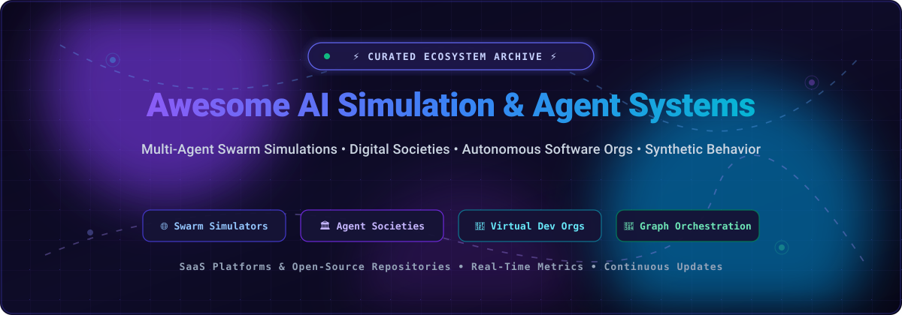

# 🌐 Awesome AI Simulation & Agent Systems 🤖

  <strong>Curated Directory of Cloud SaaS Platforms & Open-Source Repositories for Multi-Agent Swarms, Emergent Societies, Autonomous Software Organizations, and Social/Market Simulators</strong>

  <em>Discover, benchmark, and deploy state-of-the-art autonomous agent frameworks, generative persona simulations, and enterprise multi-agent workflows.</em>

---

## 📑 Table of Contents 📌

- [🌟 Overview](#-overview)
- [📊 Sector Overview & Market Dynamics](#-sector-overview--market-dynamics)
- [☁️ SaaS & Hosted Platforms](#️-saas--hosted-platforms)
- [💻 Open-Source GitHub Projects](#-open-source-github-projects)
  - [🏆 Tier 1: 50,000+ Stars (Industry Anchors & Foundations)](#-tier-1-50000-stars-industry-anchors--foundations)
  - [🚀 Tier 2: 20,000 – 50,000 Stars (Flagship Frameworks & Social Simulators)](#-tier-2-20000--50000-stars-flagship-frameworks--social-simulators)
  - [🔬 Tier 3: Emerging & Specialized Simulators (< 20,000 Stars)](#-tier-3-emerging--specialized-simulators--20000-stars)
- [📈 Star History](#-star-history)
- [🤝 How to Contribute](#-how-to-contribute)
- [☕ Support](#-support)
- [⚖️ Disclaimer & License](#️-disclaimer--license)

---

## 🌟 Overview 🔍

Welcome to the **Awesome AI Simulation & Agent Systems** index! As foundational Large Language Models (LLMs) and reasoning models evolve, the artificial intelligence frontier has transitioned from single-prompt interactions to **multi-agent simulations** and **autonomous agentic orchestration**. 

This comprehensive, SEO-optimized repository tracks production-ready **SaaS platforms** and **open-source GitHub projects** powering:
- 👥 **Emergent Social & Behavioral Simulations:** Generative agent simulacra living in sandbox worlds with memory, reflection trees, and organic relationship dynamics.
- 🐝 **Swarm Intelligence & Predictive Digital Twins:** Massively parallel agent populations evaluating public opinion, market reactions, political outcomes, and geopolitical game-theory.
- 🏢 **Autonomous Software Organizations:** Specialized virtual dev crews (PMs, Architects, Software Engineers, QA) collaborating via standardized SOPs.
- 🔄 **Graph-Based Agent Orchestration:** Stateful, event-driven multi-actor systems with cyclic graph flows, time-travel debugging, and human-in-the-loop governance.

---

## 📊 Sector Overview & Market Dynamics 📈

The global AI agent and autonomous simulation sector is projected to expand from **$5.1 billion in 2024 to over $47.1 billion by 2030, registering a compound annual growth rate (CAGR) of ~45%**, driven by surging demand for autonomous workflows, synthetic consumer intelligence, and enterprise-grade multi-agent software engineering. 

The market dynamics exhibit a **moderately fragmented architecture with selective winner-take-most concentration at the platform and orchestration layer**. While foundational LLM infrastructure and core trace/graph orchestration platforms (e.g., LangChain/LangGraph, OpenAI SDK) consolidate immense developer network effects, vertical domain simulation layers (synthetic focus groups, macroeconomic behavior modeling, and embodied gaming simulacra) remain highly fragmented among specialized AI research labs and agile startups.

---

## ☁️ SaaS & Hosted Platforms 🏢

The following hosted platforms provide managed cloud infrastructure, visual low-code/no-code canvas builders, simulation monitors, and synthetic persona engines for AI agent systems. 

*Table sorted in descending order by estimated company valuation / capital scale:*

| Company / SaaS Platform | Description & Key Capabilities | Company Size / Valuation / Funding | Starting Pricing (Specific Paid Tier) | Free Tier / Trial Limits |
| :--- | :--- | :--- | :--- | :--- |
| **[LangSmith & LangGraph Cloud](https://langchain.com)** 🔗 | Managed cloud platform for tracing, deploying, evaluating, and monitoring cyclic multi-agent graph workflows, multi-actor simulations, and production agent fleets. | **Valuation: $1.25B – $3B** ($300M Series C, backed by Sequoia & CapitalG) | **$39 / seat / month** (Plus Plan; includes 1 Serverless Agent Server & 10k traces) | **Free forever Developer Plan:** 1 user seat, 5,000 base traces/month, 14-day data retention |
| **[Aaru](https://aaru.com)** 🔗 | Enterprise AI multi-agent predictive simulation engine populating 10,000+ synthetic agent personas with behavioral telemetry to forecast consumer, market, and voting outcomes. | **Valuation: $1B** headline valuation ($50M–$80M Series A, backed by Redpoint & General Catalyst) | **Custom Enterprise SLA** (sales-led enterprise deployment; starting custom contracts) | **No self-serve free tier:** Proof-of-concept pilot provided via direct sales demo & enterprise qualification |
| **[Vellum](https://vellum.ai)** 🔗 | Multi-agent workflow testing, prompt sandbox simulation, model benchmarking, and persistent autonomous personal AI assistant infrastructure. | **Valuation: $100M – $250M** ($25.5M total funding, $20M Series A led by Leaders Fund) | **$30 / month** (Mighty Pro Package; includes 10 GiB storage & bundled usage credits) | **Free forever Base Plan:** 1 vCPU, 2 GiB RAM, 6 GiB persistent storage, managed starter LLM credentials |
| **[CrewAI Enterprise](https://crewai.com)** 🔗 | Cloud-hosted multi-agent management platform (AMP) featuring Crew Studio visual canvas, role-playing agent crews, automation triggers, and enterprise governance. | **Valuation: $50M – $100M** ($18M Series A led by Insight Partners & boldstart, $2.4M–$3.2M ARR) | **Custom Enterprise Quote** (sales-led commercial tier; legacy starting self-serve at $25/mo) | **Free forever Basic Plan:** 1 user seat, 2 active automations, capped at 50 workflow executions/month |
| **[SuperAGI Cloud](https://superagi.com)** 🔗 | Hosted autonomous AI agent infrastructure with concurrent agent execution, visual action trajectories, vector memory, and sales/GTM agentic sequences. | **Valuation: $50M – $100M** ($15M total funding, $10M Series A led by Newlands VC) | **Tiered usage credits** (GTM commercial starter tiers scale based on workflow sequences) | **Free trial & Community Open-Source:** Free initial credits on cloud signup + 100% free self-hosted open-source framework |
| **[Relevance AI](https://relevanceai.com)** 🔗 | Low-code cloud workforce engine enabling teams to build, chain, run, and audit collaborative AI agent teams across sales, support, and business simulations. | **Funding: $37M – $42M** ($24M Series B led by Bessemer Venture Partners; valuation undisclosed) | **$29 / month** (Pro Plan; annual billing option at $19/mo, plus usage meters) | **No free tier or trial:** Legacy free plan retired; full platform requires active Pro/Team plan or enterprise demo |
| **[Altera / Project Sid](https://altera.al)** 🔗 | Simulation intelligence lab generating autonomous digital human personas, game-world societies (Project Sid in Minecraft), and prosumer spreadsheet/productivity agents. | **Funding: $44.1M+ total** ($33M Series A led by Prosus, $11.1M seed/pre-seed; valuation undisclosed) | **Usage-based subscription tiers** (commercial consumer & spreadsheet agent workflows) | **7-day free trial** with starter generation tokens before transitioning into paid subscription |
| **[Artificial Societies](https://societies.ai)** 🔗 | Social simulation platform running synthetic persona networks to model viral dissemination, policy sentiment, PR crisis mitigation, and corporate communications. | **Funding: $5.35M** ($3.35M Seed led by Point72 Ventures, YC W25; valuation undisclosed) | **$40 / month** (Pro Plan for simulation access, shifting toward enterprise contracts) | **Free trial tier:** 3 free simulation credits provided upon demo qualification/signup |
| **[AgentOps](https://agentops.ai)** 🔗 | Dedicated observability, replay, and auditing suite for autonomous multi-agent systems, tracking agentic thoughts, tool execution failures, and simulation costs. | **Funding: $2.6M Pre-Seed** (backed by 645 Ventures and Afore Capital; valuation undisclosed) | **$40 / month** (Pro Plan; tiered volume pricing above included limits) | **Free forever Basic Plan:** 5,000 tracked events/month with 7-day data retention |

---

## 💻 Open-Source GitHub Projects 🛠️

A directory of top open-source repositories powering multi-agent systems, social simulators, embodied virtual worlds, and agentic infrastructure.

*Each project includes a live white-badge link to its official GitHub stargazers page and is sorted in descending order by GitHub stars:*

### 🏆 Tier 1: 50,000+ Stars (Industry Anchors & Foundations)

1. **[Significant-Gravitas/AutoGPT](https://github.com/Significant-Gravitas/AutoGPT)**   
   The iconic open-source autonomous agent experiment that catalyzed the autonomous agent movement. Enables modular agents to recursively plan, execute web tasks, browse, code, and execute multi-step objectives.

2. **[ollama/ollama](https://github.com/ollama/ollama)**   
   Essential local LLM engine powering high-volume, privacy-preserving agent simulations without per-token cloud costs. Runs Llama 3, DeepSeek, Mistral, and custom model weights locally.

3. **[vllm-project/vllm](https://github.com/vllm-project/vllm)**   
   High-throughput, low-latency LLM serving engine powered by PagedAttention. The preferred inference backbone for running hundreds of concurrent agent simulation turns across GPU clusters.

4. **[All-Hands-AI/OpenHands](https://github.com/All-Hands-AI/OpenHands)**   
   Autonomous AI software development agent capable of modifying code, executing terminal commands, opening PRs, and collaborating inside simulated development sandboxes.

5. **[666ghj/MiroFish](https://github.com/666ghj/MiroFish)**   
   Massive swarm intelligence and multi-agent simulation prediction engine. Ingests news events and seed conditions to construct high-fidelity digital societies with emergent collective behavior.

6. **[FoundationAgents/MetaGPT](https://github.com/FoundationAgents/MetaGPT)**   
   Pioneering multi-agent virtual software company framework. Assigns standardized Standard Operating Procedures (SOPs) to simulated Product Managers, Architects, Project Managers, and Engineers to produce full applications.

7. **[mem0ai/mem0](https://github.com/mem0ai/mem0)**   
   Universal long-term memory layer for AI agents. Provides scalable episodic, semantic, and working memory persistence across recurring simulation loops and conversational turns.

8. **[microsoft/autogen](https://github.com/microsoft/autogen)**   
   Microsoft's premier event-driven, conversational multi-agent framework. Supports distributed agent architectures, human-in-the-loop debugging, and complex collaborative task execution.

9. **[crewAIInc/crewAI](https://github.com/crewAIInc/crewAI)**   
   Streamlined Python framework for orchestrating collaborative role-playing autonomous AI agent crews and deterministic agentic flows with intuitive tooling and task delegation.

10. **[run-llama/llama_index](https://github.com/run-llama/llama_index)**   
    Comprehensive data framework and agent workflow system connecting private knowledge corpora and multimodal indices to autonomous agent reasoning loops.

---

### 🚀 Tier 2: 20,000 – 50,000 Stars (Flagship Frameworks & Social Simulators)

11. **[langchain-ai/langgraph](https://github.com/langchain-ai/langgraph)**   
    Stateful multi-actor agent orchestration library modeling complex agent interactions as cyclic graphs with built-in persistence, time-travel inspection, and fault tolerance.

12. **[agentscope-ai/agentscope](https://github.com/agentscope-ai/agentscope)**   
    Developer-centric multi-agent platform from Alibaba featuring distributed actor execution, customizable conversation modes, synthetic game benchmarks, and fault-tolerant communication.

13. **[OpenBMB/ChatDev](https://github.com/OpenBMB/ChatDev)**   
    Communicative agent simulation modeling a virtual software company where LLM-powered roles collaborate through design, coding, testing, and documentation chat chains.

14. **[assafelovic/gpt-researcher](https://github.com/assafelovic/gpt-researcher)**   
    Autonomous agent team conducting comprehensive, parallel online research across 20+ web sources to generate objective, detailed research dossiers.

15. **[openai/openai-agents-python](https://github.com/openai/openai-agents-python)**   
    OpenAI's production-grade multi-agent library standardizing agent definitions, tool delegation, guardrails, and deterministic state transitions.

16. **[joonspk-research/generative_agents](https://github.com/joonspk-research/generative_agents)**   
    The landmark Stanford Smallville simulation architecture demonstrating 25 believable generative agents living in an interactive RPG town with reflection and memory trees.

17. **[openai/swarm](https://github.com/openai/swarm)**   
    Educational and ergonomic exploration of lightweight multi-agent patterns centered on routines, stateless agent handoffs, and direct function execution.

---

### 🔬 Tier 3: Emerging & Specialized Simulators (< 20,000 Stars)

18. **[camel-ai/camel](https://github.com/camel-ai/camel)**   
    Pioneering communicative agent framework ("Communicative Agents for Mind Exploration") designed for autonomous role-playing cooperation, task exploration, and synthetic training data generation.

19. **[TransformerOptimus/SuperAGI](https://github.com/TransformerOptimus/SuperAGI)**   
    Dev-first autonomous AI agent framework supporting concurrent agent provisioning, graphical action replay, vector database storage, and external tool integration.

20. **[a16z-infra/ai-town](https://github.com/a16z-infra/ai-town)**   
    Deployable starter kit by a16z Infra for hosting real-time virtual towns where AI characters socialize, remember conversations, and interact across a TypeScript/Convex stack.

21. **[microsoft/TinyTroupe](https://github.com/microsoft/TinyTroupe)**   
    Microsoft's multi-agent persona simulation library tailored for synthetic focus groups, consumer product ideation, audience feedback, and cognitive simulation.

22. **[MineDojo/Voyager](https://github.com/MineDojo/Voyager)**   
    First open-ended embodied lifelong learning agent in Minecraft driven by LLMs. Autonomously writes, refines, and stores procedural action skills in a vector memory library.

23. **[camel-ai/oasis](https://github.com/camel-ai/oasis)**   
    CAMEL-AI's Open Agent Social Interaction Simulator capable of orchestrating up to one million autonomous LLM agents in synthetic Twitter/X and Reddit social ecosystems.

24. **[OpenBMB/AgentVerse](https://github.com/OpenBMB/AgentVerse)**   
    Flexible multi-agent simulation and task-solving environment designed to observe emergent group dynamics, negotiation, and collaborative problem-solving.

25. **[mesa/mesa](https://github.com/mesa/mesa)**   
    The premier Python agent-based modeling (ABM) framework for social sciences, epidemiology, and economics, increasingly integrated with LLMs for cognitive behavioral modeling.

26. **[Farama-Foundation/PettingZoo](https://github.com/Farama-Foundation/PettingZoo)**   
    Standard Gymnasium-equivalent API for multi-agent reinforcement learning (MARL) benchmarks, multi-agent game environments, and competitive simulations.

27. **[google-deepmind/concordia](https://github.com/google-deepmind/concordia)**   
    Google DeepMind's library for generative social simulations where communicative agents interact in grounded economic, social, and game-theoretic scenarios mediated by a Game Master LLM.

28. **[google-deepmind/meltingpot](https://github.com/google-deepmind/meltingpot)**   
    DeepMind's simulation benchmark suite measuring generalized artificial social intelligence, cooperation, and social dilemma dynamics in multi-agent environments.

29. **[sotopia-lab/sotopia](https://github.com/sotopia-lab/sotopia)**   
    Open-ended social learning environment evaluating social negotiation, cooperation, deception, and interpersonal dynamics between communicating LLM agents.

---

## 📈 Star History 📊

---

## 🤝 How to Contribute 💡

Contributions are warmly welcome to keep this directory comprehensive and up to date! 🌟

1. **Fork the repository** to your personal GitHub account.
2. **Create a descriptive feature branch**: `git checkout -b feature/add-new-simulator`.
3. **Add your SaaS product or open-source tool**:
   - For SaaS products: Include specific starting tier pricing, free plan/trial limits, and company scale/valuation in the tabular format.
   - For open-source projects: Include the GitHub repository link, live shields.io star badge with white background linking to stargazers, and a concise capability description.
4. **Sort into the proper rank/section**.
5. **Submit a Pull Request** with a brief summary of the added technology.

---

## ☕ Support 💖

If you found this curated ecosystem useful for your research, company simulations, or agent architectures:
- ⭐ **Star this repository** to help others discover it!
- 🍴 **Fork it** to build your own custom curated sub-indexes.
- 📢 **Share it** with the AI engineering and simulation community.
- ☕ **Sponsor & Buy a Coffee:** [Sponsor Dashboard on GitHub](https://github.com/sponsors/ishandutta2007)

---

## ⚖️ Disclaimer & License 📜

- **Disclaimer:** All product names, logos, and brands are property of their respective owners. Company valuations, funding metrics, and pricing plans reflect publicly reported information and may change over time.
- **License:** Distributed under the [MIT License](LICENSE). Copyright © 2026 Ishan Dutta.
